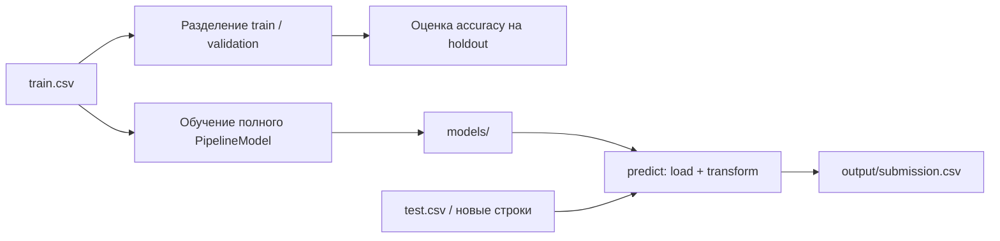

# Spark ML · Kaggle Lab

**Scala, Apache Spark и воспроизводимые эксперименты машинного обучения.**

Лаборатория из пяти соревнований Kaggle: от прогнозирования выживаемости и стоимости недвижимости до распознавания рукописных цифр и классификации твитов. Проект объединяет подготовку признаков, оценку моделей и генерацию submission CSV в отдельных sbt-модулях.

В модулях **Spaceship Titanic**, **Digit Recognizer** и **Disaster Tweets** обучение и пакетный инференс разделены: сохранённый `PipelineModel` содержит обработку признаков и классификатор. Для новых предсказаний достаточно модели и входного CSV.

## Соревнования

| Модуль | Задача | Модели | Запуск и результаты |
| --- | --- | --- | --- |
| `titanic` | Выживание пассажиров; accuracy/AUC | RandomForest, GBT, LogisticRegression, XGBoost, ансамбли | [Руководство](competitions/titanic/README.md) · [Результаты](competitions/titanic/RESULTS.md) |
| `housePrices` | Стоимость недвижимости; log-RMSE | ElasticNet, RandomForest, GBT, XGBoost, ансамбли | [Руководство](competitions/house-prices/README.md) · [Результаты](competitions/house-prices/RESULTS.md) |
| `spaceshipTitanic` | Перенос пассажиров в другое измерение; accuracy | RandomForest/GBT с признаками каюты и расходов | [Руководство](competitions/spaceship-titanic/README.md) · [Результаты](competitions/spaceship-titanic/RESULTS.md) |
| `digitRecognizer` | Цифры MNIST, 10 классов; accuracy | Multinomial LogisticRegression, 784 пикселя | [Руководство](competitions/digit-recognizer/README.md) · [Статус](competitions/digit-recognizer/RESULTS.md) |
| `disasterTweets` | Твиты о катастрофах; бинарный F1 | TF-IDF слов/биграмм + LogisticRegression | [Руководство](competitions/disaster-tweets/README.md) · [Результаты](competitions/disaster-tweets/RESULTS.md) |

Новые задачи выбраны из [Spaceship Titanic](https://www.kaggle.com/competitions/spaceship-titanic), [Digit Recognizer](https://www.kaggle.com/competitions/digit-recognizer) и [NLP with Disaster Tweets](https://www.kaggle.com/competitions/nlp-getting-started): они добавляют бинарную, многоклассовую и текстовую классификацию. Измеренные локальные метрики и статус отправки находятся в `RESULTS.md` каждого модуля.

Реальный запуск Spaceship Titanic (2026-10-26): лучший локальный вариант GBT — **holdout accuracy 0.82279**, обработанный сабмит Kaggle **57670441** — **public accuracy 0.79588**. Данные, сравнение трёх конфигураций и команды воспроизведения — в [журнале результатов](competitions/spaceship-titanic/RESULTS.md).

## Быстрый старт

Нужны **JDK 11** и **sbt 1.11.3**. Scala **2.12.18** и Spark **3.5.9** заданы в `build.sbt`. Для скачивания данных понадобится настроенный [Kaggle CLI](https://github.com/Kaggle/kaggle-api).

Из корня репозитория:

```bash
# Собрать все модули.
./bin/sbt-local compile

# Посмотреть команды нового пайплайна без загрузки данных.
./bin/sbt-local "spaceshipTitanic/run --help"

# Скачать данные со своей учётной записью Kaggle.
kaggle competitions download -c spaceship-titanic -p competitions/spaceship-titanic/data/raw
unzip competitions/spaceship-titanic/data/raw/spaceship-titanic.zip -d competitions/spaceship-titanic/data/raw

# Оценить на holdout, обучить на всех размеченных строках и сохранить модель.
./bin/sbt-local "spaceshipTitanic/run train"

# Загрузить модель и получить предсказания без повторного обучения.
./bin/sbt-local "spaceshipTitanic/run predict"
```

Результат: `competitions/spaceship-titanic/output/submission.csv` с колонками `PassengerId,Transported`. Перед скачиванием проверьте условия участия на странице соревнования. Данные и credentials не входят в репозиторий.

`bin/sbt-local` хранит кеши зависимостей в рабочем каталоге. Первый запуск требует сети; для компиляции данные Kaggle не нужны. При `sbt run` пути `data/raw/`, `models/` и `output/` отсчитываются **от каталога выбранного соревнования**.

## Обучение → модель → инференс



В новых модулях `train` сохраняет модель, `predict` выполняет только инференс, `run` объединяет оба шага. Импутация и категоризация обучаются внутри пайплайна: при проверке на holdout используется только обучающая часть. Существующий файл или модель защищены от перезаписи; для повторного запуска задайте новый путь либо `--overwrite`.

Titanic и House Prices используют свои экспериментальные команды: `./bin/sbt-local "titanic/run"` и `./bin/sbt-local "housePrices/run"`. Их параметры и особенности описаны в руководствах модулей.

## Структура

```text
spark-ml/
├── build.sbt                 # Модули и зависимости
├── bin/sbt-local             # Обёртка sbt с локальными кешами
├── docs/README.md            # Архитектура, CLI, проверка и разработка
├── modules/core/             # Общий lifecycle новых классификаторов
└── competitions/
    ├── titanic/
    ├── house-prices/
    ├── spaceship-titanic/
    ├── digit-recognizer/
    └── disaster-tweets/
        ├── README.md        # Данные, обучение, инференс
        ├── RESULTS.md       # Статус и журнал экспериментов
        ├── data/raw/        # Входные данные, не коммитятся
        ├── models/          # Сохранённые пайплайны
        ├── output/          # Submission CSV
        └── src/             # Scala-код, ресурсы и тесты новых модулей
```

## Проверка и разработка

```bash
./bin/sbt-local "core/test" "spaceshipTitanic/test" "digitRecognizer/test" "disasterTweets/test"
```

Тесты используют небольшие синтетические данные и проверяют сохранение/загрузку модели, инференс без `train.csv`, порядок `ImageId`, ведущие нули `PassengerId`, формат submission и ошибочные входы. Они не измеряют качество на реальных данных Kaggle.

Подробности: [документация проекта](docs/README.md), [правила участия в разработке](AGENTS.md). Для изменений модели фиксируйте seed, параметры, локальную метрику и путь артефакта в `RESULTS.md` своего соревнования.
